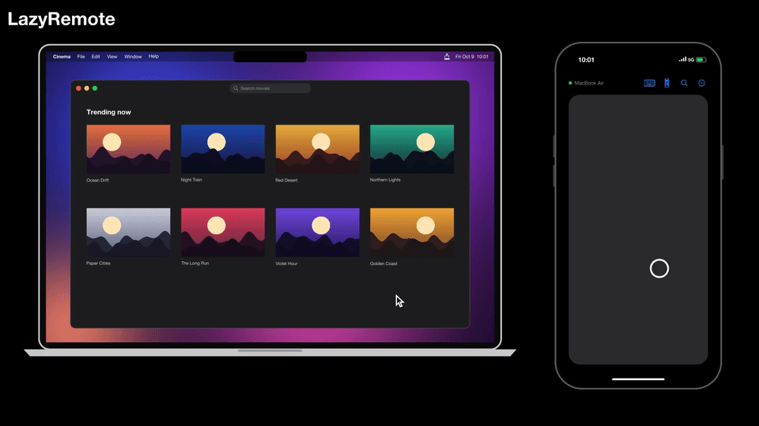
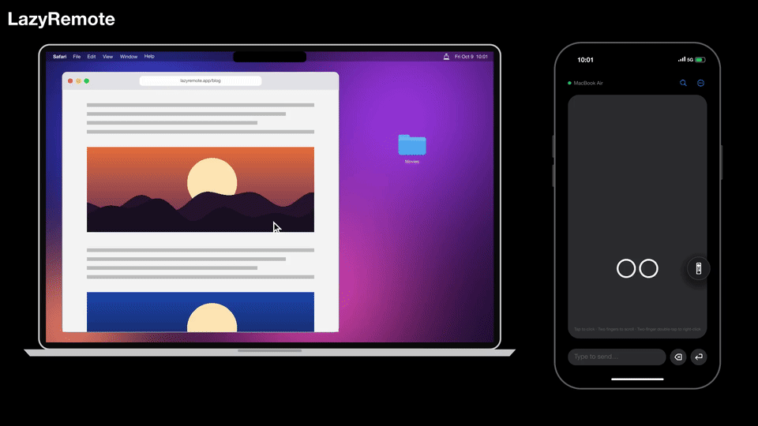
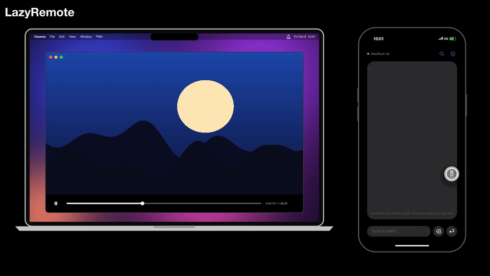
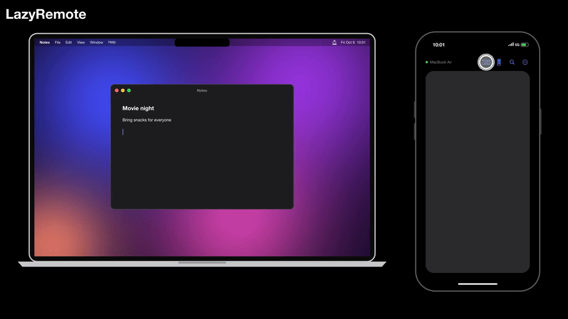
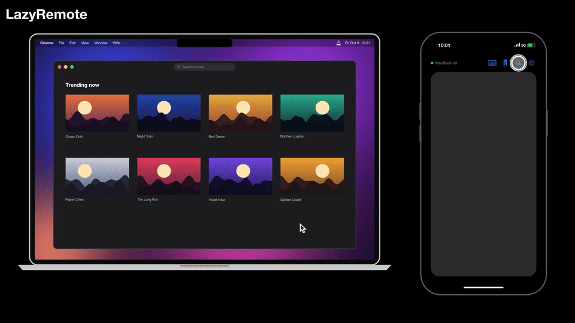

# LazyRemote

Use your iPhone as a remote for your Mac, over Bluetooth.


**[Website](https://ibrahimaltay.github.io/lazy-remote-for-desktop/)** · **[Download for Mac](https://github.com/ibrahimaltay/lazy-remote-for-desktop/releases/latest)** · iPhone app coming soon to the App Store

## See It in Action

### Trackpad

Move the cursor with one finger. Tap to click (double- and triple-tap work too), and two-finger tap to right-click.



Scroll with two fingers and the page glides on. Long-press, then move, to drag. Swipe with three fingers to switch desktops, open Mission Control or show all windows of an app.



### Floating Remote

The Remote and Keyboard buttons sit in the top bar; drag either one out to float it anywhere, or back to dock it. Tap Remote for a big D-pad: arrow keys for slides, menus and videos (hold one to repeat it), Space in the center, play/pause and track buttons, plus brightness and volume.



### Keyboard

Tap the keyboard button and type: the words appear on your Mac as you type, in any language, emoji included. Autocorrect and dictation fixes follow along. Tap Send to press Return and start fresh. Tap Close or outside to stop.



### Spotlight

Tap the magnifier and type. Your Mac's Spotlight results show up on your iPhone as you type; press go to open the top one.



## Features

- **Arrow keys & play/pause:** control videos and presentations without leaving your seat.
- **Floating Remote and Keyboard:** two buttons docked in the top bar; drag one out to place it anywhere on the screen, or back to dock it. Tap Remote for the D-pad, Keyboard to type.
- **Trackpad:** move the cursor; tap to click, two-finger tap to right-click.
- **Gestures:** two-finger scroll with momentum, long-press to drag, and three-finger swipe for desktops and Mission Control.
- **Keyboard:** tap the keyboard button and type; the words appear on your Mac as you type.
- **Any language and emoji:** type in any script, emoji included.
- **Spotlight:** opens Spotlight on your Mac by sending ⌘ Space, then type your search from the iPhone. Results appear on your iPhone as you type (view only). Press go to open the top result, or tap outside to cancel. A custom Spotlight shortcut isn't supported.
- **Direct and encrypted:** connects over Bluetooth, with no Wi-Fi setup or accounts.
- **Free:** no ads, no tracking, no in-app purchases.

## Installation

### iPhone

The iPhone app will be on the App Store soon.

### Mac

1. Download `LazyRemote.dmg` from the [latest release](https://github.com/ibrahimaltay/lazy-remote-for-desktop/releases/latest).
2. Open `LazyRemote.dmg`.
3. Drag **LazyRemote** into the **Applications** folder.

## Quickstart

1. On your Mac, open **LazyRemote**.
2. When macOS asks for Bluetooth access, select **Allow**.
3. Make sure that the LazyRemote icon comes into view in the menu bar.
4. Click the LazyRemote icon.
5. Select **Open Accessibility Settings…**.
6. Set **LazyRemote** to on.

   **Note:** LazyRemote must have Accessibility access to send key presses and clicks to your Mac.

7. On your iPhone, open **LazyRemote**.
8. When iOS asks for Bluetooth access, select **Allow**.
9. On your Mac, click the LazyRemote icon in the menu bar.
10. Select **Allow** followed by the name of your iPhone.
11. Make sure that the iPhone shows the name of your Mac with a green dot.
12. Use the trackpad to control your Mac. To type, tap the keyboard button in the top bar and start typing; the text appears on your Mac as you go.

## Reset Pairing

To remove every phone's access and pair again:

1. On the Mac, open the LazyRemote menu and select **Forget All Devices…**.
2. Confirm **Forget All Devices**. Connected phones lose access and all saved phone approvals are removed.
3. On each iPhone, select **Reconnect** from the ellipsis menu.
4. On the Mac, select **Allow** for each phone you want to pair again.

The reset works even when **Enabled** is off. It preserves the Mac's identity,
Enabled setting, Launch at Login preference, and Accessibility permission.
Turn Enabled back on before reconnecting if it was off. The iPhone normally
does not need **Forget Mac**, because the Mac's identity has not changed.
This resets LazyRemote approvals, not system Bluetooth bonds.

If the menu shows **Pairing Reset Failed…**, open it for details and retry
**Forget All Devices…**. Access stays blocked for the current app run until the
reset succeeds. Do not assume restarting clears approvals: a failed deletion
can leave them saved.


## Development

Shared, testable behavior lives in the Swift package under `Sources/`:
`RemoteProtocol` defines wire encodings, `RemoteSecurity` handles encrypted
sessions and Keychain trust, and `RemoteClientCore`/`RemoteServerCore` implement
the iPhone central and Mac peripheral. The SwiftUI shells are in `iOSApp/` and
`macApp/`. There is no Wi-Fi or Bonjour transport.

The package supports macOS 13 / iOS 17; the apps target macOS 14 / iOS 17.
Swift 6 strict concurrency is enabled. Both apps require Bluetooth permission;
Mac input injection also requires Accessibility access and a stable code identity.
The Mac app is a non-sandboxed, hardened-runtime menu-bar app.

```sh
swift build
swift test
swift test --filter RemoteSecurityTests
swift test --filter SecureHandshakeTests/testPinnedHandshakeAndKeyConfirmation

xcodegen generate
xcodebuild -project MacRemote.xcodeproj -scheme MacRemote \
  -configuration Debug -derivedDataPath .build/dd -quiet build
xcodebuild -project MacRemote.xcodeproj -scheme RemoteDPad \
  -configuration Debug -sdk iphonesimulator \
  -destination 'generic/platform=iOS Simulator' -derivedDataPath .build/dd -quiet build
open .build/dd/Build/Products/Debug/LazyRemote.app
```

`swift test` covers the package targets; filter by target, class, or
`ClassName/testMethodName`. There is no configured lint command.
`project.yml` is the XcodeGen source of truth, including app versions. Generate
before opening/building a fresh checkout and after changing project settings or
adding/removing app files. The Xcode project and both app Info.plists are generated
and ignored; keep lasting configuration changes in `project.yml`.

The retained `remotectl` harness exercises `keytest`, `swipe`, `serve`, and `send`
without a phone. Package it with `scripts/make-app.sh` before Mac injection tests:
a bare executable lacks the stable code identity needed for dependable events.
Its `serve --allow-new` option is for testing only.

Trackpad gain, direction, gestures, and phone-side momentum are tuned in
`Sources/RemoteClientCore/Resources/TrackpadTuning.json`, bundled with the client.
`RemoteClientCoreTests` covers this behavior. The Mac posts continuous scroll
events rather than calculating momentum.

Read [docs/secure-protocol.md](docs/secure-protocol.md) before changing wire bytes,
handshake, trust, or transport. Builds and unit tests do not establish physical
secure-v2 BLE behavior or complete the documented release gates. Custom key mapping
and controlling multiple Macs simultaneously from one phone remain out of scope.

## Website and distribution

The website is ordinary static HTML in `site/`, deployed by
`.github/workflows/pages.yml`. The workflow copies the `readme-gifs/*.gif`
demos into the Pages artifact. No JavaScript or frontend build is required.
Support is at the homepage's `#support` section, and the canonical published
privacy policy is [site/privacy.html](site/privacy.html); `PRIVACY.md` points to
that single maintained policy. The original App Store badge is a local SVG asset.

The intended distribution is a free Mac app through GitHub/website and a free
iPhone app through the App Store. App Store distribution remains a goal, not
already completed.

`scripts/release-mac.sh` creates a Developer ID signed, notarized, stapled DMG in
`.build/release/` and requires a configured notarytool profile. Each release must
attach the unversioned `LazyRemote.dmg` it produces because the website links to
`releases/latest/download/LazyRemote.dmg`. Signing/notarization and App Store
readiness still require validation; see the
[outstanding release gates](docs/secure-protocol.md#outstanding-release-gates).

## License

MIT — see [LICENSE](LICENSE).
